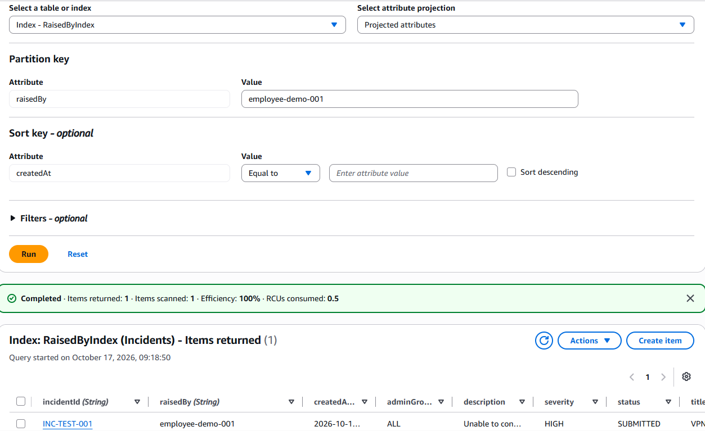
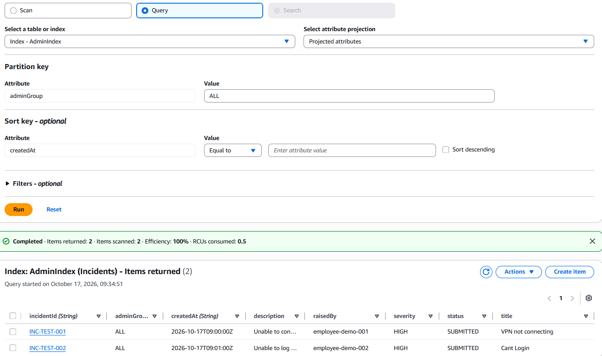
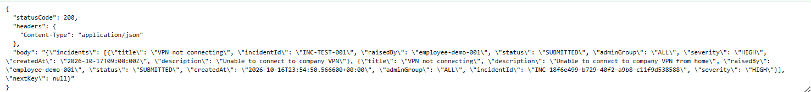
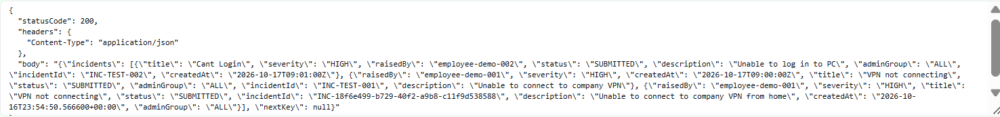
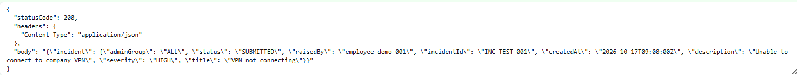
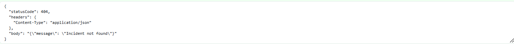
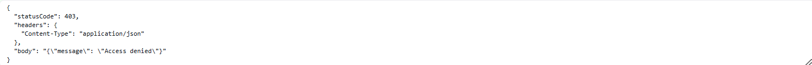

# AWS Infrastructure Implementation Log

**Project:** AWS Incident Management Platform — Project Resilience  
**Environment:** Proof of Concept (PoC)  
**AWS Region:** `ap-southeast-2` (Sydney)  
**Deployment Method:** AWS Management Console

> **Testing scope:** The Lambda functions have been tested directly in the AWS Lambda Console using simulated JWT claims. Real Cognito authentication and API Gateway authorisation have **not** yet been tested.

---

## 1. Amazon DynamoDB

**Resource:** `Incidents` table  
**Status:** Deployed — Console tests passed

### 1.1 Purpose

DynamoDB stores submitted incident records. The data model supports employee access to their own incidents and administrator access to all incidents without routine table scans.

### 1.2 Table Configuration

| Setting | Value |
|---|---|
| Table Name | `Incidents` |
| Partition Key | `incidentId` (String) |
| Sort Key | None |
| Capacity Mode | On-demand |
| Table Class | Standard |
| Region | `ap-southeast-2` |

### 1.3 Global Secondary Indexes

| Index | Partition Key | Sort Key | Access Pattern |
|---|---|---|---|
| `RaisedByIndex` | `raisedBy` | `createdAt` | Retrieve incidents submitted by one employee |
| `AdminIndex` | `adminGroup` | `createdAt` | Retrieve all incidents using `adminGroup = ALL` |

Both indexes support timestamp-ordered queries within their partition key values.

### 1.4 Testing

A synthetic incident was inserted manually through the DynamoDB Console.

| Test | Expected Result | Status |
|---|---|---|
| Manual incident creation | Record stored | PASS |
| Employee index query | `RaisedByIndex` returns matching records | PASS |
| Administrator index query | `AdminIndex` returns records under `ALL` | PASS |

### 1.5 Test Evidence

**Employee query**

**Administrator query**

### 1.6 Architectural Considerations

- On-demand capacity keeps operational management low for this PoC.
- Global Secondary Indexes are eventually consistent.
- Primary-table `GetItem` requests can use strongly consistent reads.
- The shared `AdminIndex` partition key (`ALL`) may become a scalability constraint at substantially higher throughput.
- Production capacity, load, and availability targets have not been validated.

---

## 2. AWS Lambda — CreateIncident

**Function:** `CreateIncident`  
**Runtime:** Python 3.14  
**Status:** Deployed — Lambda Console tests passed

### 2.1 Purpose

`CreateIncident` validates incident submissions, identifies the submitting user, writes an incident to DynamoDB, and confirms creation only after DynamoDB acknowledges the write.

### 2.2 Implementation

The function uses Python and Boto3 to:

1. Parse the incoming JSON request body.
2. Validate `title` (required, maximum 150 characters), `description` (required, maximum 2,000 characters), and `severity` (`LOW`, `MEDIUM`, or `HIGH`).
3. Read the user's `sub` and group membership from the JWT claims structure supplied in the Lambda event.
4. Require membership of `Employees` or `ITAdmins`.
5. Generate an `INC-<UUID>` reference and UTC `createdAt` timestamp.
6. Write an item with `incidentId`, `raisedBy`, `adminGroup`, `createdAt`, `title`, `description`, `severity`, and `status` (`SUBMITTED`).
7. Return HTTP `201 Created` with the incident reference following a successful `PutItem` call.

A conditional expression (`attribute_not_exists(incidentId)`) prevents overwriting an existing item with the same key.

The function takes `raisedBy` from the claims structure, **not** from a user-supplied ticket field. These claims are simulated in current tests; they must only be trusted in production when supplied by a correctly configured API Gateway JWT authorizer.

### 2.3 IAM Permissions

The execution role has:

- Basic Lambda permissions for CloudWatch Logs.
- `dynamodb:PutItem` on the `Incidents` table.

The write function does not require DynamoDB scan, read, or delete permissions.

### 2.4 Testing

Tests were run directly in the Lambda Console.

| Test | Expected Result | Status |
|---|---|---|
| Valid incident submission | HTTP `201 Created` | PASS |
| DynamoDB record verification | New item present in `Incidents` | PASS |
| Unsupported severity (`CRITICAL`) | HTTP `400 Bad Request` | PASS |
| Missing user identity | HTTP `401 Unauthorized` | PASS |
| Unauthorised group | HTTP `403 Forbidden` | PASS |

The `401` and `403` cases test application logic with **simulated JWT claims**, not real authentication.

### 2.5 Architectural Considerations

- UUID references avoid maintaining a central sequence counter but are not sequential ticket numbers.
- Conditional `PutItem` protects against key collisions, **not** duplicate submissions caused by retries.
- Request-level idempotency and handling of ambiguous network timeouts remain outstanding.
- CloudWatch alarms and production-grade error handling remain outstanding.

---

## 3. AWS Lambda — ReadIncident

**Function:** `ReadIncident`  
**Runtime:** Python 3.14  
**Status:** Deployed — Lambda Console tests passed

### 3.1 Purpose

`ReadIncident` retrieves tickets using the existing DynamoDB indexes and checks that an authenticated employee can access only their own incident records, while an IT administrator can retrieve all incidents.

### 3.2 Implemented Operations

| Operation | Data Access | Behaviour |
|---|---|---|
| List employee incidents | `Query` on `RaisedByIndex` | Filter by the user's `sub` |
| List administrator incidents | `Query` on `AdminIndex` | Query `adminGroup = ALL` |
| Retrieve one incident | `GetItem` on `Incidents` | Return only if user is the owner or an IT administrator |

Listing queries use `ScanIndexForward=False` (newest first) and a limit of 25 evaluated items per query. The function returns `LastEvaluatedKey` as `nextKey` when DynamoDB provides one, but **client-driven pagination is not yet implemented**.

Individual incident reads use `ConsistentRead=True` on the primary table.

### 3.3 Planned API Gateway Routes

| Method | Route | Purpose |
|---|---|---|
| `GET` | `/incidents` | List incidents accessible to the user |
| `GET` | `/incidents/{id}` | Retrieve one authorised incident |

Both route paths are already handled by the Lambda code using the event's `routeKey`. **API Gateway has not yet been deployed or connected.**

### 3.4 IAM Permissions

The execution role has:

- Basic Lambda permissions for CloudWatch Logs.
- `dynamodb:GetItem` on the `Incidents` table.
- `dynamodb:Query` on `RaisedByIndex` and `AdminIndex`.

No incident write or delete permissions are required.

### 3.5 Authorisation and Error Handling

- The Lambda reads user `sub` and group claims from the request context.
- Membership of `Employees` or `ITAdmins` is required.
- Employees query only their own `raisedBy` value for ticket listings.
- For individual tickets, Lambda checks ownership **after** DynamoDB returns the record and **before** returning it to the caller.
- An employee requesting another user's incident receives HTTP `404`, avoiding disclosure of whether that incident exists.
- Missing identity returns `401`; an unapproved group returns `403`; a missing incident returns `404`.
- AWS read errors are handled with a generic HTTP `500` response while details are logged.

**Security boundary:** DynamoDB GSIs organise data for efficient querying; they do not enforce user-level access. Real identity claims must be validated by API Gateway before they can be trusted.

### 3.6 Testing

All tests below were run with simulated request events in the Lambda Console.

| Test | Expected Result | Status |
|---|---|---|
| Employee lists own incidents | HTTP `200`; own incidents returned | PASS |
| Administrator lists incidents | HTTP `200`; incidents returned from `AdminIndex` | PASS |
| Employee retrieves own incident by ID | HTTP `200`; incident returned | PASS |
| Administrator retrieves incident by ID | HTTP `200`; incident returned | PASS |
| Employee requests another user's incident | HTTP `404`; incident not disclosed | PASS |
| Missing user identity | HTTP `401` | PASS |
| Unauthorised group | HTTP `403` | PASS |
| Nonexistent incident ID | HTTP `404` | PASS |

**Employee Read Test**

**Admin Read Test**

**Query Ticket ID Test**

**Query Other User's Tickets Test**

**Wrong Group Permissions Test**

### 3.7 Architectural Considerations

- Global Secondary Indexes are eventually consistent; the strongly consistent individual `GetItem` reads use the main table.
- Pagination beyond the first page still needs a validated continuation-token design and frontend support.
- The `AdminIndex` shared partition key may require redesign at scale.
- The authorisation decisions have been tested with simulated claims, **not** with genuine Cognito tokens.
- Load, concurrency, and operational failure scenarios have not yet been tested.

---

## 4. Outstanding Work / Next Steps

### 4.1 DynamoDB

- [x] Deploy `Incidents` table and both GSIs.
- [x] Validate employee and administrator queries.
- [x] Capture and document DynamoDB query screenshots.

### 4.2 CreateIncident Lambda

- [x] Deploy Python 3.14 Lambda and configure DynamoDB write permission.
- [x] Verify HTTP `201` and persisted incident record.
- [x] Verify HTTP `400`, `401`, and `403` rejection cases.
- [ ] Implement request-level idempotency and robust timeout handling.

### 4.3 ReadIncident Lambda

- [x] Deploy Python 3.14 Lambda and configure table/index read permissions.
- [x] Test employee and administrator list queries.
- [x] Test individual incident retrieval and ownership restrictions.
- [x] Verify HTTP `200`, `401`, `403`, and `404` response cases.
- [x] Document implementation and test results.
- [ ] Capture ReadIncident test screenshots for GitHub.
- [ ] Implement and test pagination across multiple result pages.

### 4.4 API Gateway and Cognito

- [ ] Configure Cognito user pool, approved test users, and `Employees` / `ITAdmins` groups.
- [ ] Disable public self-registration.
- [ ] Create API Gateway HTTP API routes and Lambda integrations.
- [ ] Require JWT authorisation on every incident route.
- [ ] Configure CORS and test real authentication and record-level authorisation.

### 4.5 Frontend Hosting

- [ ] Create a private S3 static-site origin and CloudFront distribution with Origin Access Control.
- [ ] Implement sign-in, incident submission, employee incident list, and administrator dashboard.
- [ ] Test end-to-end workflows through API Gateway.

### 4.6 Notifications

- [ ] Enable DynamoDB Streams on `Incidents`.
- [ ] Implement notification Lambda and Amazon SES integration.
- [ ] Configure failure handling and confirm notification errors do not block incident creation.

### 4.7 Monitoring, Reliability, and Cost

- [ ] Configure CloudWatch monitoring and alarms.
- [ ] Test failure scenarios and revisit retry/idempotency behaviour.
- [ ] Verify AWS budget alerts and review actual charges.
- [ ] Review IAM scope and clean up unnecessary resources.

---

## 5. Implementation Summary

### 5.1 Component Status

| Component | Status |
|---|---|
| DynamoDB `Incidents` table | Deployed — Tests passed |
| `RaisedByIndex` and `AdminIndex` | Deployed — Queries passed |
| `CreateIncident` Lambda | Deployed — Lambda Console tests passed |
| `ReadIncident` Lambda | Deployed — Lambda Console tests passed |
| API Gateway | Not yet deployed |
| Amazon Cognito | Not yet configured |
| S3 and CloudFront frontend | Not yet deployed |
| DynamoDB Streams | Not yet enabled |
| Notification Lambda and Amazon SES | Not yet configured |

### 5.2 Current Milestone and Next Step

The project now has a working serverless **write path** (`CreateIncident` → DynamoDB) and **read path** (`ReadIncident` → DynamoDB), both verified with Lambda Console test events. Employee ownership checks and administrator access have also passed simulated-claim tests.

**Next milestone:** Configure Cognito and API Gateway so these operations can be tested using genuinely authenticated HTTP requests. The current Lambda tests do not establish production-ready security or reliability.
