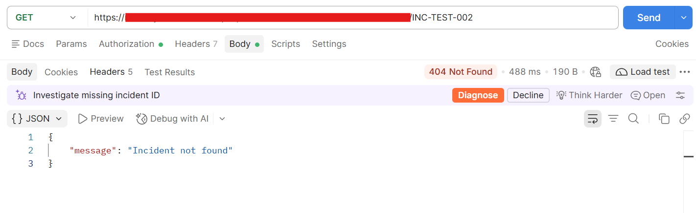
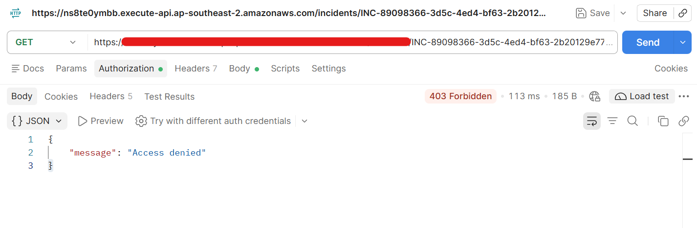
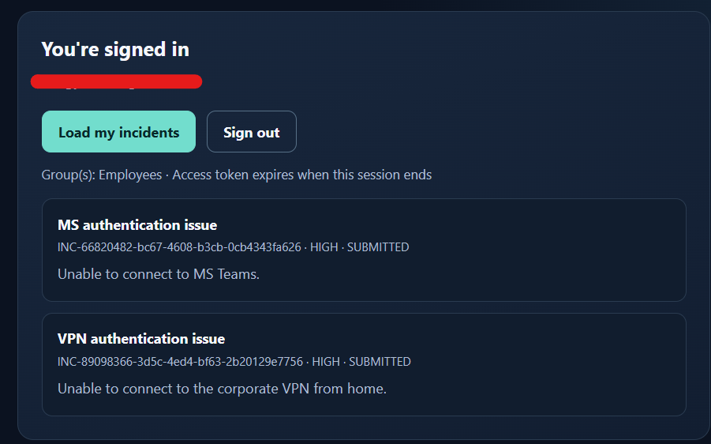
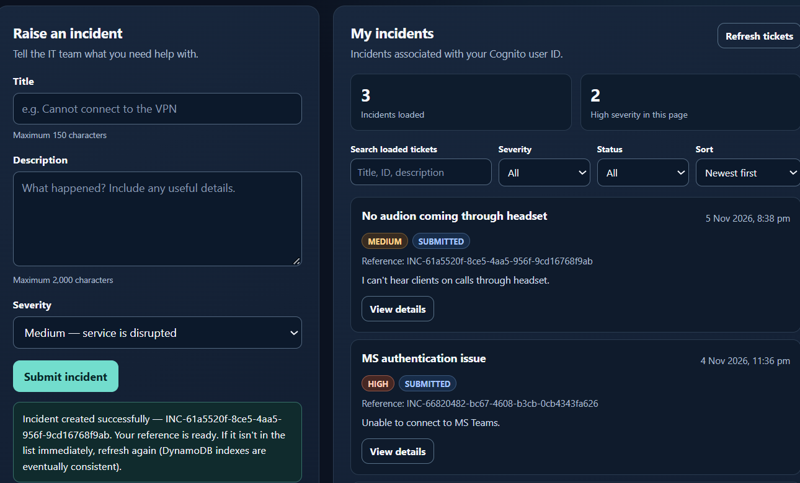
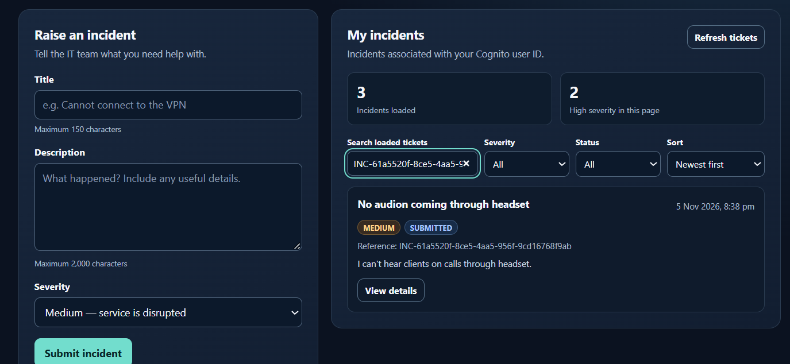

# AWS Infrastructure Implementation Log

**Project:** AWS Incident Management Platform — Project Resilience  
**Environment:** Proof of Concept (PoC)  
**AWS Region:** `ap-southeast-2` (Sydney)  
**Deployment method:** AWS Management Console  
**Last updated:** 4 November 2026

> **Scope of verification:** DynamoDB and both Lambda functions have passed direct-console tests. A real Cognito employee has also authenticated, submitted an incident through API Gateway, and retrieved it using the authenticated API. Live administrator and cross-user authorisation tests, pagination, and frontend integration are **not yet complete**. Direct Lambda tests with mocked JWT claims do not prove real authentication.

---

## 1. Project Status and System Flow

### 1.1 Deployment Status

| Component | Current status | Verified capability |
|---|---|---|
| DynamoDB `Incidents` table | Deployed | Manual write and GSI queries |
| `RaisedByIndex` / `AdminIndex` | Deployed | Employee/admin query patterns in DynamoDB Console |
| Lambda `CreateIncident` | Deployed | Direct Lambda tests and authenticated API write |
| Lambda `ReadIncident` | Deployed | Direct Lambda tests and authenticated employee list retrieval |
| Amazon Cognito | Configured | Employee login and real access token issued |
| API Gateway `ProjectResilienceAPI` | Deployed | Unauthenticated GET rejection, authenticated employee POST and GET |
| Private S3 / CloudFront frontend | Not deployed | — |
| DynamoDB Streams / notification Lambda / SES | Not deployed | — |

### 1.2 Current Request Paths

**Write path (verified with a real employee token):**

`Postman → Cognito access token → API Gateway POST /incidents → CreateIncident → DynamoDB`

**Read path (verified for employee incident listing):**

`Postman → Cognito access token → API Gateway GET /incidents → ReadIncident → RaisedByIndex`

**Planned browser path:**

`Browser → CloudFront → private S3 (HTML/CSS/JavaScript)`; browser JavaScript will call API Gateway directly using Cognito access tokens.

**Planned asynchronous path:**

`DynamoDB Streams → notification Lambda → Amazon SES`. This is not implemented yet.

---

## 2. Architecture Decisions and Constraints

These decisions explain **why** the services and access patterns were chosen. Implementation details are in Section 3; **all test results and screenshots are in Section 4**.

### 2.1 DynamoDB-First Incident Creation

The application writes an incident to DynamoDB **before** returning HTTP `201 Created`. A successful database write is therefore a prerequisite for confirming submission to the employee. Notification delivery will be handled asynchronously so an email failure does not block ticket creation.

The write uses `attribute_not_exists(incidentId)` to avoid overwriting an existing incident key. This does **not** provide request-level idempotency: retries can still create separate tickets with new UUIDs.

### 2.2 Incident Identifiers

Incident IDs use the format `INC-<UUID>`. UUIDs avoid a central counter and permit independent Lambda invocations to generate identifiers. Sequential public ticket numbers were considered but deferred to avoid additional coordination, cost and failure modes.

### 2.3 DynamoDB Access Patterns

- The base table uses `incidentId` as its partition key, with no sort key.
- `RaisedByIndex` queries `raisedBy = <authenticated Cognito sub>` with `createdAt` as the sort key.
- `AdminIndex` queries `adminGroup = ALL` with `createdAt` as the sort key.
- Individual ticket requests use base-table `GetItem`, followed by an application-level ownership check.
- Global Secondary Indexes are **eventually consistent**; base-table `GetItem` supports strongly consistent reads.

The shared `ALL` key is reasonable at PoC scale but might become a throughput constraint at much higher scale. Neither index is a security boundary; **Lambda enforces record-level permissions**.

### 2.4 Authentication and API Design

Cognito authenticates users and issues access tokens. The API Gateway HTTP API validates JWTs before invoking Lambda. Lambda then checks approved Cognito groups (`Employees`, `ITAdmins`) and, for employee records, the matching `raisedBy` value.

An HTTP API was selected for straightforward Lambda proxy integration and native JWT authorisation. A REST API is **not required** to use CloudFront. The initial design uses CloudFront for static frontend hosting and direct browser requests to API Gateway, with CORS configured for the CloudFront origin when available.

### 2.5 Known Limitations

- Real administrator listing and employee cross-user rejection remain unverified through API Gateway.
- The current read Lambda returns a `nextKey` when available, but the caller cannot yet request subsequent pages.
- The full incident-create flow does not yet handle ambiguous write timeouts and duplicate request retries robustly.
- CloudWatch alarms, load testing, failure-recovery tests and production security hardening are outstanding.
- Browser CORS and Cognito redirect integration have not yet been tested against a deployed frontend.

---

## 3. Component Implementation Record

Each component is documented in one place: **purpose, deployed configuration, execution behaviour and permissions**. Test outcomes are deliberately kept out of this section.

### 3.1 Amazon DynamoDB — `Incidents`

**Purpose:** Persist tickets and support employee and administrator read patterns without routine table scans.

**Deployed table configuration**

| Setting | Value |
|---|---|
| Table name | `Incidents` |
| Partition key | `incidentId` (String) |
| Sort key | None |
| Capacity mode | On-demand |
| Table class | Standard |
| Region | `ap-southeast-2` |

**Deployed global secondary indexes**

| Index | Partition key | Sort key | Used by |
|---|---|---|---|
| `RaisedByIndex` | `raisedBy` | `createdAt` | Employee list requests |
| `AdminIndex` | `adminGroup` | `createdAt` | Administrator list requests |

The incident item stores `incidentId`, `raisedBy`, `adminGroup`, `createdAt`, `title`, `description`, `severity` and `status`.

### 3.2 AWS Lambda — `CreateIncident`

**Purpose:** Validate a new incident, derive the submitting user's identity, persist the ticket, and return its reference.

**Deployed configuration:** Python 3.14, Lambda proxy-compatible response format, Sydney region.

**Execution sequence**

1. Parse the JSON request body.
2. Validate `title` (required, maximum 150 characters), `description` (required, maximum 2,000 characters) and `severity` (`LOW`, `MEDIUM`, `HIGH`).
3. Read Cognito `sub` and group claims from the API Gateway JWT request context.
4. Require membership in `Employees` or `ITAdmins`.
5. Generate `INC-<UUID>` and a UTC `createdAt` timestamp.
6. Call DynamoDB `PutItem` with `status = SUBMITTED`, `raisedBy = sub`, and `adminGroup = ALL`.
7. Return HTTP `201` and the incident reference after DynamoDB acknowledges the write.

**IAM execution-role permissions**

- Basic CloudWatch Logs permissions.
- `dynamodb:PutItem` for the `Incidents` table only.
- No DynamoDB read, scan or delete permission is required by this function.

### 3.3 AWS Lambda — `ReadIncident`

**Purpose:** Retrieve lists or individual incident records while enforcing employee/admin access restrictions.

**Deployed configuration:** Python 3.14, Sydney region, HTTP API payload format `2.0`.

**Implemented read operations**

| API route | DynamoDB operation | Access rule |
|---|---|---|
| `GET /incidents` — Employee | `Query` on `RaisedByIndex` | Query only the caller's Cognito `sub` |
| `GET /incidents` — Admin | `Query` on `AdminIndex` | Query `adminGroup = ALL` |
| `GET /incidents/{id}` | `GetItem` on `Incidents` | Owner or `ITAdmins` membership required |

List queries use `ScanIndexForward=False` (newest first) and evaluate up to 25 items per query. They can return `LastEvaluatedKey` as `nextKey`, but the next-page request mechanism is unfinished. Individual `GetItem` requests use `ConsistentRead=True`.

**Application responses:** `200` on successful reads, `401` if identity is missing, `403` for an unapproved group, `404` for a missing incident or another employee's record, and a generic `500` for handled AWS read errors. The `404` ownership response avoids revealing whether another person's ticket exists.

**IAM execution-role permissions**

- Basic CloudWatch Logs permissions.
- `dynamodb:GetItem` on the `Incidents` table.
- `dynamodb:Query` on `RaisedByIndex` and `AdminIndex`.
- No incident write or delete permission is required by this function.

### 3.4 Amazon Cognito — Authentication

**Purpose:** Authenticate approved test users and issue access tokens for the API.

**Configured settings**

| Setting | Value |
|---|---|
| Region | `ap-southeast-2` |
| SPA app client | `ProjectResilienceWeb` |
| User sign-in | Email and password |
| Groups | `Employees`, `ITAdmins` |
| Hosted login domain | `project-resilience-demo.auth.ap-southeast-2.amazoncognito.com` |
| OAuth flow | Authorization Code with PKCE |
| Client secret | None for the browser-based SPA |
| Test client | Postman |

Registered callback URLs must exactly match the OAuth client's redirect URL. During setup, a callback mismatch was corrected and an expired temporary password was reset administratively. The public self-registration setting still needs an explicit documented verification.

### 3.5 Amazon API Gateway — `ProjectResilienceAPI`

**Purpose:** Expose HTTPS incident endpoints, validate Cognito JWTs and route authorised requests to Lambda.

**Deployed type:** HTTP API with Lambda proxy payload format `2.0`.

| Method | Route | Lambda integration |
|---|---|---|
| `POST` | `/incidents` | `CreateIncident` |
| `GET` | `/incidents` | `ReadIncident` |
| `GET` | `/incidents/{id}` | `ReadIncident` |

**Authorizer design**

- Type: JWT, backed by the Cognito user pool.
- Identity source: `$request.header.Authorization`.
- Issuer format: `https://cognito-idp.ap-southeast-2.amazonaws.com/<USER_POOL_ID>`.
- Audience: Cognito SPA app client ID.
- Calls use a Cognito OAuth **access token**.
- API Gateway has permission to invoke the Lambda integrations; the Lambda execution roles separately grant their DynamoDB permissions.

---

## 4. Validation, Test Results and Evidence

**All completed and pending tests are documented here**, separated by test layer. A **PASS** means the result was explicitly observed; **PENDING** means it has not yet been confirmed.

### 4.1 DynamoDB Console Tests

| Test | Expected result | Status |
|---|---|---|
| Manually create a synthetic incident | Record stored | **PASS** |
| Query `RaisedByIndex` | Matching employee records returned | **PASS** |
| Query `AdminIndex` | Records with `adminGroup = ALL` returned | **PASS** |

**Evidence — Employee index query**

**Evidence — Administrator index query**

### 4.2 `CreateIncident` — Direct Lambda Console Tests

*These tests used simulated API Gateway events and mocked JWT claims, not genuine Cognito authentication.*

| Test | Expected response / result | Status |
|---|---|---|
| Valid incident submission | HTTP `201` | **PASS** |
| Database persistence | New incident exists in `Incidents` | **PASS** |
| Unsupported severity `CRITICAL` | HTTP `400` | **PASS** |
| Missing identity (`sub`) | HTTP `401` | **PASS** |
| Unauthorised group | HTTP `403` | **PASS** |

### 4.3 `ReadIncident` — Direct Lambda Console Tests

*These tests also used mocked JWT claims.*

| Test | Expected response / result | Status |
|---|---|---|
| Employee lists own incidents | HTTP `200`, matching records | **PASS** |
| Administrator lists incidents | HTTP `200`, admin index results | **PASS** |
| Employee retrieves own incident by ID | HTTP `200` | **PASS** |
| Administrator retrieves incident by ID | HTTP `200` | **PASS** |
| Employee requests another user's incident | HTTP `404`, no record disclosed | **PASS** |
| Missing identity | HTTP `401` | **PASS** |
| Unauthorised group | HTTP `403` | **PASS** |
| Unknown incident ID | HTTP `404` | **PASS** |

**Evidence — Employee list**

**Evidence — Administrator list**

**Evidence — Individual ticket**

**Evidence — Another user's ticket denied**

**Evidence — Unapproved group**

### 4.4 Cognito and API Gateway — Live Postman Tests

*These are HTTP requests using a real Cognito employee and access token, not mocked claims.*

| Test | Observed or expected result | Status |
|---|---|---|
| Employee logs in through Cognito and obtains token | OAuth authentication completed | **PASS** |
| `GET /incidents` without bearer token | HTTP `401 Unauthorized` | **PASS** |
| Employee uses real token for `POST /incidents` | HTTP `201`, incident created | **PASS** |
| Verify incident persisted in DynamoDB | Incident stored with caller's `raisedBy = sub` | **PASS** |
| Employee uses real token for `GET /incidents` | HTTP `200`, new ticket returned | **PASS** |
| Employee gets their own incident via `GET /incidents/{id}` | HTTP `200` | **PASS** |
| Administrator lists incidents with real token | HTTP `200`, includes multiple users' records | **PASS** |
| Employee reads another user's incident by ID | HTTP `404` | **PASS** |
| Missing token on POST and individual-GET routes | HTTP `401` for both | **PASS** |
| Real-token unapproved group | HTTP `403` | **PASS** |
| Pagination across multiple result pages | Correct continuation, no missing/duplicate items | **PENDING** |
| Browser-based CORS and OAuth callback from CloudFront | Browser can complete login and API calls | **PASS** |

**Evidence — Authenticated incident creation (POST)**

An employee authenticated with a real Cognito access token and successfully created an incident through API Gateway (`HTTP 201`).

**Evidence — Authenticated employee incident retrieval (GET)**

The same employee retrieved the new incident through `GET /incidents` (`HTTP 200`), confirming the record was associated with their Cognito `sub`.

**Evidence — Authenticated employee incident retrieval of another users ticket (GET)**

The same employee tries to retrieve another users incidents through querying the ID

**Evidence - Authenticated employee tretriving tickets without group membership (GET)**

The same employee tries to retrieve tickets when they are not a member of the required groups

**Evidence - Autheticated Admin retrieving all tickets (GET)**

User within the Admin group doesn't a query on /incidents

### 4.5 CloudFront Incident Portal — Browser-Based End-to-End API Tests

*These tests were performed through the deployed Southern Cross IT Services Incident Portal, hosted on Amazon S3 and delivered via CloudFront. Unlike the previous Postman tests, these validate the complete browser-based application using real Amazon Cognito authentication, OAuth 2.0 Authorization Code with PKCE, API Gateway, Lambda and DynamoDB.*

*Testing was performed using separate Cognito accounts assigned to the `Employees` and `ITAdmins` groups.*

| Test | Observed or expected result | Status |
|---|---|---|
| Access application through CloudFront | Frontend successfully loads from private S3 bucket via CloudFront | **PASS** |
| Employee authenticates through Cognito | Hosted login completes and redirects to CloudFront with an authenticated session | **PASS** |
| Browser OAuth 2.0 Authorization Code + PKCE flow | Authorisation code exchanged successfully and authenticated session established | **PASS** |
| Browser-based cross-origin API requests (CORS) | CloudFront-hosted JavaScript successfully communicates with API Gateway | **PASS** |
| Employee retrieves incidents using `GET /incidents` | Employee dashboard loads incidents associated with their Cognito identity | **PASS** |
| Employee access restriction | Employee dashboard does not expose incidents belonging to other employees | **PASS** |
| Employee creates incident using submission form | Authenticated `POST /incidents` successfully creates an incident and returns a reference | **PASS** |
| Employee views individual incident using `GET /incidents/{id}` | Selected incident details successfully retrieved and displayed | **PASS** |
| Administrator authenticates through Cognito | Account assigned to `ITAdmins` successfully accesses the administrator dashboard | **PASS** |
| Administrator retrieves incidents using `GET /incidents` | Administrator dashboard displays incidents created by multiple employees | **PASS** |
| Role-based dashboard behaviour | Employee and administrator accounts receive different incident views based on group membership | **PASS** |
| Administrator retrieves an individual employee incident by ID | Administrator can access incident details belonging to another employee | **PASS** |
| Incident submission form rejects invalid input | Missing required fields, invalid severity and oversized input are rejected appropriately | **PASS** |
| Pagination across multiple result pages | User can retrieve additional incidents beyond the initial DynamoDB query page | **PENDING** |
| Session expiry and sign-out behaviour | Expired sessions cannot access protected APIs; sign-out clears the browser session | **PASS** |

**Evidence — Employee incident dashboard**

An authenticated employee successfully retrieves incidents through `GET /incidents`. The dashboard displays records associated with that employee's Cognito identity, demonstrating role-based and record-level access restrictions.

**Evidence — Browser-based incident creation**

An authenticated employee submits an incident using the web form, providing a title, description and severity. The application successfully invokes `POST /incidents` and displays the generated incident reference.

**Evidence — Administrator incident dashboard**

A user assigned to the Cognito `ITAdmins` group successfully retrieves incidents created by multiple employees through `GET /incidents`, demonstrating organisation-wide visibility for authorised administrators.

**Evidence — Individual incident retrieval**

The portal retrieves and displays an individual incident using `GET /incidents/{id}` with the authenticated user's access token.

**Validation outcome**

Browser-based testing confirms that the application supports the core incident management workflow:

- Secure employee and administrator authentication using Cognito.
- Authenticated incident submission and retrieval through API Gateway.
- Role-based incident visibility enforced by the backend.
- Browser-based communication across the CloudFront and API Gateway origins.
- End-to-end integration between the frontend, Lambda and DynamoDB.

The core functional requirements for incident submission, employee incident visibility and administrator incident visibility have been validated through the deployed application.

**Outstanding validation:** Pagination, detailed form validation

---

## 5. Outstanding Work and Next Milestones

### 5.1 Complete Live API Security Validation

- [x] Obtain a real `ITAdmins` access token and verify administrator listing.
- [x] Verify employee `GET /incidents/{id}` for their own ticket.
- [x] Verify a real employee receives `404` when requesting another user's ticket.
- [x] Verify missing-token rejection on POST and individual-GET routes.
- [x] Verify JWT authorisation and required scopes are attached to all three routes.
- [x] Confirm Cognito public self-registration is disabled.
- [x] Link authenticated POST and GET Postman screenshots in Section 4.4.

### 5.2 Build the Frontend

- [x] Create a **private** S3 bucket for static site files.
- [x] Configure CloudFront with Origin Access Control (OAC).
- [x] Create the login/logout and incident submission UI.
- [x] Create employee list and administrator dashboard views.
- [x] Add the CloudFront HTTPS callback URL to Cognito.
- [x] Configure API Gateway CORS for the CloudFront origin.
- [x] Test real browser-based workflows end to end.

### 5.3 Implement Asynchronous Notifications

- [ ] Enable DynamoDB Streams for the `Incidents` table.
- [ ] Build the notification Lambda and integrate Amazon SES.
- [ ] Verify notifications cannot block successful synchronous ticket creation.
- [ ] Configure retries, failure handling and monitoring.

### 5.4 Reliability, Security and Cost Improvements

- [ ] Add request-level idempotency and robust ambiguous-timeout handling to creation.
- [ ] Implement and test secure, functional next-page pagination for read queries.
- [ ] Add CloudWatch monitoring and alarms; test failure cases.
- [ ] Review IAM scope, deployed-resource costs and AWS budget alerts.
- [ ] Review operational readiness, availability and scalability assumptions before any production use.

**Next milestone:** Complete real-token administrator and cross-user access tests, then deploy the private S3 + CloudFront frontend. Pagination and broader production hardening can remain explicitly tracked PoC improvements.
