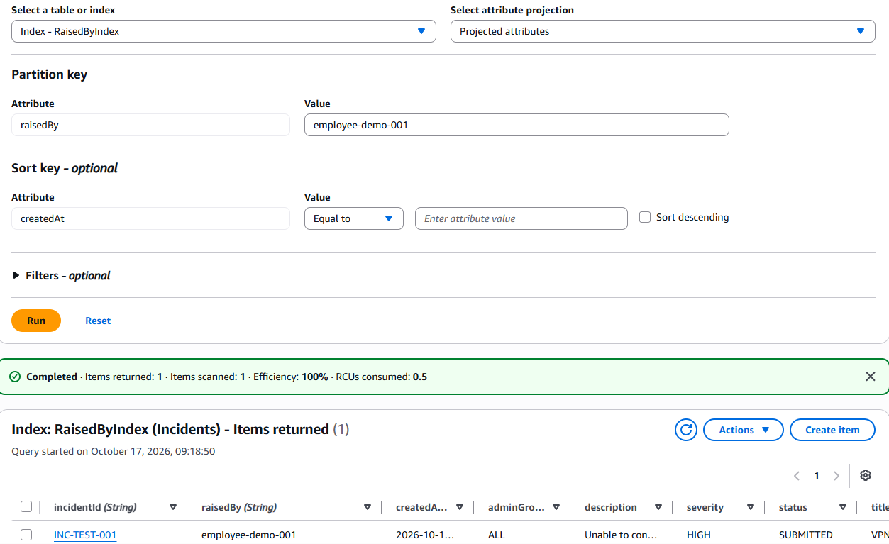
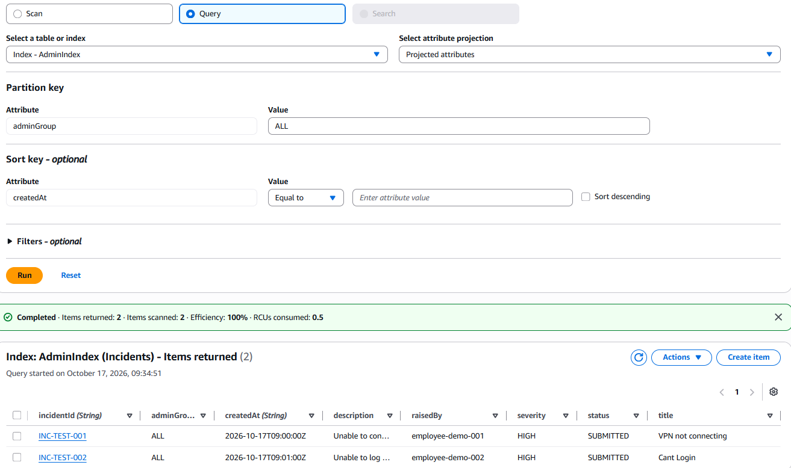
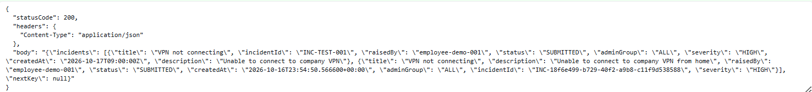
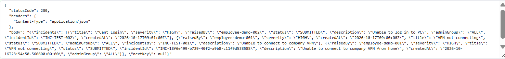
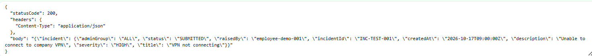
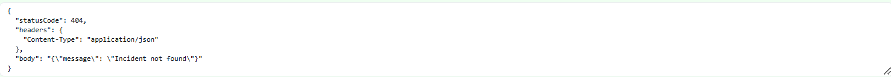
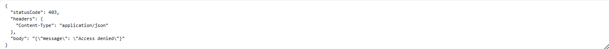
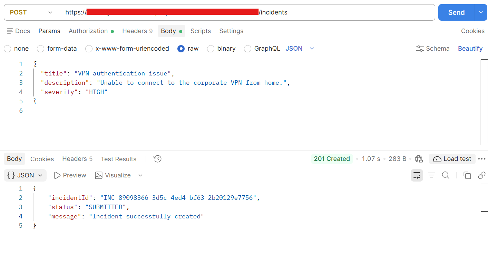
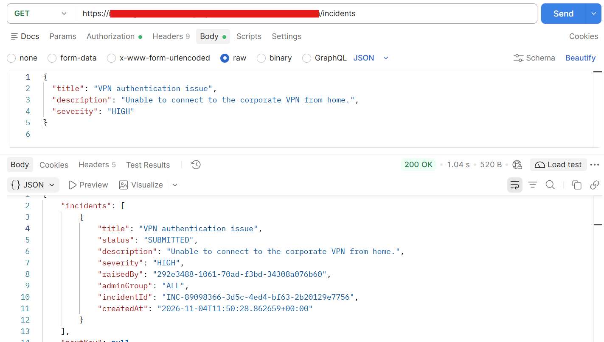

# AWS Infrastructure Implementation Log

**Project:** AWS Incident Management Platform — Project Resilience  
**Environment:** Proof of Concept (PoC)  
**AWS Region:** `ap-southeast-2` (Sydney)  
**Deployment Method:** AWS Management Console  
**Last updated:** 4 November 2026

> **Testing scope:** DynamoDB and both Lambda functions have passed initial direct-console tests. Cognito authentication and the API Gateway **employee write/read flow have now also been verified using a real Cognito access token**. Live administrator access, cross-user ownership rejection, and pagination are still outstanding. This is a PoC, not a production security or reliability certification.

---

## 1. Amazon DynamoDB

**Resource:** `Incidents` table  
**Status:** Deployed — Initial tests passed

### 1.1 Purpose

DynamoDB stores submitted incident records. The data model supports employees retrieving their own incidents and IT administrators retrieving all incidents without relying on routine table scans.

### 1.2 Table Configuration

| Setting | Value |
|---|---|
| Table name | `Incidents` |
| Partition key | `incidentId` (String) |
| Sort key | None |
| Capacity mode | On-demand |
| Table class | Standard |
| Region | `ap-southeast-2` |

### 1.3 Global Secondary Indexes

| Index | Partition key | Sort key | Access pattern |
|---|---|---|---|
| `RaisedByIndex` | `raisedBy` | `createdAt` | List incidents belonging to an employee |
| `AdminIndex` | `adminGroup` | `createdAt` | List incidents with `adminGroup = ALL` |

Both indexes support timestamp-ordered queries within a selected partition key. The sort direction is controlled by the caller.

### 1.4 Testing

A synthetic incident was created manually in the DynamoDB Console, and both index queries were tested.

| Test | Expected result | Status |
|---|---|---|
| Manual incident creation | Record stored | **PASS** |
| Employee index query | `RaisedByIndex` returns matching records | **PASS** |
| Administrator index query | `AdminIndex` returns records under `ALL` | **PASS** |

### 1.5 Test Evidence

**Employee index query**

**Administrator index query**

### 1.6 Architectural Considerations

- On-demand capacity keeps operational management low for this PoC.
- Global Secondary Indexes are eventually consistent.
- Primary-table `GetItem` requests can use strongly consistent reads.
- The shared `AdminIndex` partition key (`ALL`) may become a scalability constraint at high throughput.
- Production capacity, load, and availability targets have not been validated.

---

## 2. AWS Lambda — CreateIncident

**Function:** `CreateIncident`  
**Runtime:** Python 3.14  
**Status:** Deployed — Direct Lambda tests and authenticated API creation verified

### 2.1 Purpose

`CreateIncident` validates incoming incident details, identifies the authenticated user, stores an incident in DynamoDB, and returns a reference only after DynamoDB acknowledges the write.

### 2.2 Implementation

The function uses Python and Boto3 to:

1. Parse the incoming JSON body.
2. Validate `title` (required, maximum 150 characters), `description` (required, maximum 2,000 characters), and `severity` (`LOW`, `MEDIUM`, `HIGH`).
3. Extract the user's `sub` and groups from the API Gateway JWT authorizer claims structure.
4. Require membership in `Employees` or `ITAdmins`.
5. Generate an `INC-<UUID>` reference and UTC `createdAt` timestamp.
6. Write `incidentId`, `raisedBy`, `adminGroup`, `createdAt`, `title`, `description`, `severity`, and `status = SUBMITTED` to DynamoDB.
7. Return HTTP `201 Created` after a successful `PutItem` operation.

A conditional expression, `attribute_not_exists(incidentId)`, prevents overwriting another record with the same incident ID. The `raisedBy` value is obtained from the validated identity context, **not** from a user-supplied request field.

### 2.3 IAM Permissions

The execution role grants:

- CloudWatch Logs permissions for Lambda execution logging.
- `dynamodb:PutItem` on the `Incidents` table.

The function does not need DynamoDB read, scan, or delete permissions.

### 2.4 Testing

**Direct Lambda Console tests (simulated claims)**

| Test | Expected result | Status |
|---|---|---|
| Valid incident submission | HTTP `201` | **PASS** |
| DynamoDB record verification | New record persisted | **PASS** |
| Unsupported severity (`CRITICAL`) | HTTP `400` | **PASS** |
| Missing user identity | HTTP `401` | **PASS** |
| Unauthorised group | HTTP `403` | **PASS** |

**Live authenticated API test**

| Test | Expected result | Status |
|---|---|---|
| Cognito employee submits `POST /incidents` through API Gateway | HTTP `201`; incident written | **PASS** |
| Same employee subsequently retrieves the new incident in `GET /incidents` | HTTP `200`; matching record returned | **PASS** |

The live tests use a genuine Cognito access token; the earlier Lambda Console tests use synthetic claims. See **Section 6** for the end-to-end test record.

### 2.5 Architectural Considerations

- UUID references avoid maintaining a central sequence counter but are not sequential ticket numbers.
- Conditional `PutItem` prevents key collisions, **not** duplicate submissions caused by retries.
- Request-level idempotency and ambiguous timeout handling remain outstanding.
- Production-grade error handling, monitoring and alarms remain outstanding.

---

## 3. AWS Lambda — ReadIncident

**Function:** `ReadIncident`  
**Runtime:** Python 3.14  
**Status:** Deployed — Direct Lambda tests passed; authenticated employee list retrieval verified

### 3.1 Purpose

`ReadIncident` retrieves incident records while enforcing application-level permissions: employees may read their own tickets, whereas IT administrators may read all tickets.

### 3.2 Implemented Operations

| Operation | Data access | Behaviour |
|---|---|---|
| List employee incidents | `Query` on `RaisedByIndex` | Partition key equals the authenticated user's `sub` |
| List administrator incidents | `Query` on `AdminIndex` | Partition key equals `ALL` |
| Retrieve individual incident | `GetItem` on `Incidents` | Return only to the owner or an `ITAdmins` member |

List queries use `ScanIndexForward=False` (newest first) and evaluate up to 25 items per request. The current function can return DynamoDB's `LastEvaluatedKey` as `nextKey`, but **accepting a continuation token and fetching subsequent pages has not been implemented**. Individual ticket retrieval uses `ConsistentRead=True` on the main table.

### 3.3 API Gateway Routes

| Method | Route | Integration |
|---|---|---|
| `GET` | `/incidents` | `ReadIncident` |
| `GET` | `/incidents/{id}` | `ReadIncident` |

These routes have been configured in the deployed HTTP API. The authenticated `GET /incidents` route has been tested with a real Cognito employee. Real-token individual-item and cross-user tests are still outstanding.

### 3.4 IAM Permissions

The execution role grants:

- CloudWatch Logs permissions for Lambda execution logging.
- `dynamodb:GetItem` on the `Incidents` table.
- `dynamodb:Query` on the `RaisedByIndex` and `AdminIndex` GSIs.

No incident write or delete permissions are required.

### 3.5 Authorisation and Error Handling

- The Lambda extracts `sub` and `cognito:groups` from the request context supplied by API Gateway.
- Membership of `Employees` or `ITAdmins` is required.
- Employee list queries are scoped to their own `raisedBy` value.
- For individual reads, ownership is checked **after** `GetItem` but **before** returning the record.
- An employee requesting another user's incident receives `404` so the response does not disclose whether the ticket exists.
- Missing identity returns `401`; an unapproved group returns `403`; missing incidents return `404`.
- AWS read errors generate a generic `500` response while diagnostic details are logged.

**Security boundary:** DynamoDB indexes are efficient access patterns, not authorisation controls. Cognito and API Gateway validate identity; Lambda implements the record-level permission checks.

### 3.6 Testing

**Direct Lambda Console tests (simulated claims)**

| Test | Expected result | Status |
|---|---|---|
| Employee lists own incidents | HTTP `200`; own records returned | **PASS** |
| Administrator lists incidents | HTTP `200`; records from `AdminIndex` | **PASS** |
| Employee retrieves own incident by ID | HTTP `200` | **PASS** |
| Administrator retrieves incident by ID | HTTP `200` | **PASS** |
| Employee requests another user's incident | HTTP `404` | **PASS** |
| Missing user identity | HTTP `401` | **PASS** |
| Unauthorised group | HTTP `403` | **PASS** |
| Nonexistent incident ID | HTTP `404` | **PASS** |

**Live authenticated API tests**

| Test | Expected result | Status |
|---|---|---|
| Employee calls `GET /incidents` with genuine Cognito access token | HTTP `200` | **PASS** |
| Employee sees incident submitted under their own Cognito `sub` | Correct ticket in results | **PASS** |
| Administrator lists tickets with real Cognito token | HTTP `200`; cross-user results | **PENDING** |
| Employee requests another user's ticket by ID | HTTP `404` | **PENDING** |
| Employee retrieves own ticket by ID | HTTP `200` | **PENDING** |
| Multiple-page pagination | No missing/duplicate records between pages | **PENDING** |

### 3.7 Test Evidence

**Lambda Console — Employee list**

**Lambda Console — Administrator list**

**Lambda Console — Individual incident**

**Lambda Console — Other user's incident denied**

**Lambda Console — Unauthorised group**

**Postman / live API evidence:** Screenshots of authenticated incident creation and employee retrieval have been committed and pushed to the repository. Their exact new filenames were not supplied with this document, so the links should be added here after checking `screenshots/` in GitHub Desktop.

<!-- Add links once the precise uploaded filenames are confirmed, for example:

-->

### 3.8 Architectural Considerations

- GSIs provide eventually consistent results; `GetItem` on the main table can be strongly consistent.
- Cursor-based pagination needs implementation, validation and frontend support.
- The `AdminIndex` shared partition key may need redesign at higher scale.
- Real Cognito employee listing has been verified, but **live administrator and cross-user security tests remain outstanding**.
- Load, concurrency and operational failure scenarios have not yet been tested.

---

## 4. Amazon Cognito — Authentication

**Resource:** Cognito user pool and SPA app client  
**Status:** Configured — Real employee sign-in and token-based API access verified

### 4.1 Purpose

Cognito authenticates users and issues signed access tokens. API Gateway validates these tokens before requests reach Lambda. Lambda then applies group and incident ownership rules.

### 4.2 Configuration

| Setting | Configuration |
|---|---|
| Region | `ap-southeast-2` |
| Application client | `ProjectResilienceWeb` (browser-based SPA) |
| User sign-in | Email/password |
| Groups | `Employees`, `ITAdmins` |
| Cognito domain | `project-resilience-demo.auth.ap-southeast-2.amazoncognito.com` |
| OAuth design | Authorization Code with PKCE |
| Client secret | None for the SPA client |
| Testing client | Postman |

Callback URLs must be registered in Cognito and exactly match the URL sent by the OAuth client. A Postman callback mismatch was encountered and corrected during setup. A test user's expired temporary password also required an administrator reset before successful sign-in.

### 4.3 Testing

| Test | Expected result | Status |
|---|---|---|
| Cognito employee signs in | OAuth flow completes and provides an access token | **PASS** |
| Employee access token is accepted by API Gateway | Authenticated request succeeds | **PASS** |
| Administrator authenticates and exercises read permissions | Authorized admin access | **PENDING** |
| Public self-registration setting verified disabled | Only approved users may register | **NOT YET RECORDED** |

### 4.4 Security Considerations

- Do not commit JWTs, passwords, app secrets or refresh tokens to GitHub.
- Login alone does not grant access to every ticket; group checks and ownership checks are required in Lambda.
- The test accounts and OAuth configuration are suitable for a PoC, not a complete production identity-security review.

---

## 5. Amazon API Gateway — HTTP API

**Resource:** `ProjectResilienceAPI`  
**Type:** HTTP API  
**Status:** Deployed — Unauthenticated rejection and employee read/write integration verified

### 5.1 Purpose

API Gateway provides the public HTTPS endpoint for incident operations, validates Cognito JWTs and invokes the relevant Lambda function.

### 5.2 Route Configuration

| Method | Route | Lambda integration |
|---|---|---|
| `POST` | `/incidents` | `CreateIncident` |
| `GET` | `/incidents` | `ReadIncident` |
| `GET` | `/incidents/{id}` | `ReadIncident` |

The integrations use HTTP API Lambda proxy payload format `2.0`. API Gateway has permission to invoke the Lambda functions; the Lambdas' separate execution roles permit their DynamoDB operations.

### 5.3 JWT Authorisation

The API uses a Cognito-backed JWT authorizer. The configured design uses:

- Identity source: `$request.header.Authorization`
- Issuer: Cognito user pool issuer (`https://cognito-idp.ap-southeast-2.amazonaws.com/<USER_POOL_ID>`)
- Audience: Cognito SPA app client ID
- OAuth access tokens for calling protected API routes

**Verified behaviour:** `GET /incidents` without a bearer token returns HTTP `401 Unauthorized`, while a request with the employee's genuine Cognito access token returns HTTP `200`.

**Still to verify and record:** The authorizer and any required scopes are attached to **every** route, including `POST /incidents` and `GET /incidents/{id}`. Successful authenticated POST is confirmed; explicit no-token rejection checks for all routes have not all been documented.

### 5.4 Testing

| Test | Expected result | Status |
|---|---|---|
| `GET /incidents` with no token | HTTP `401` | **PASS** |
| `GET /incidents` with real employee token | HTTP `200` | **PASS** |
| `POST /incidents` with real employee token | HTTP `201`; record created | **PASS** |
| Read newly created record via authenticated employee list | New incident returned | **PASS** |
| `GET /incidents/{id}` with real token | HTTP `200` for authorised user | **PENDING** |
| POST/individual GET without token | HTTP `401` | **PENDING** |
| Real administrator and cross-user permissions | Correct `200`/`404` outcomes | **PENDING** |
| Browser CORS from eventual CloudFront frontend | Allowed origin/methods/headers configured | **PENDING** |

### 5.5 Architectural Considerations

- An HTTP API meets current routing and JWT needs without requiring a REST API's built-in edge-optimised endpoint.
- CloudFront will initially serve the static frontend; the browser will call API Gateway directly.
- CORS must be configured for the eventual CloudFront origin before browser-based API calls can work.
- Successful requests from Postman do **not** prove browser CORS is configured correctly.

---

## 6. Authenticated End-to-End Test Record

**Test client:** Postman  
**Identity:** Real Cognito `Employees` test account  
**Status:** Core employee workflow passed

### 6.1 Validated Write and Read Sequence

1. Sign in through Cognito with Authorization Code + PKCE.
2. Obtain and attach an OAuth access token in Postman.
3. Submit `POST /incidents` with a valid title, description and severity.
4. Receive `201 Created`; verify the incident is stored in DynamoDB.
5. Send `GET /incidents` with the same employee token.
6. Receive `200 OK` and observe the incident created by that account.

The initial employee list was empty because previous test records had a synthetic `raisedBy` identifier. Creating a ticket with the real Cognito account correctly populated `raisedBy` with that user's `sub`, allowing `RaisedByIndex` to return it on the next request.

### 6.2 Results

| Scenario | Actual observed result | Status |
|---|---|---|
| Request without a token | `GET /incidents` rejected with `401` | **PASS** |
| Employee authenticates with Cognito | Access token obtained and accepted | **PASS** |
| Employee creates an incident | `201`; record persisted | **PASS** |
| Employee lists own incidents | `200`; new record visible | **PASS** |
| Administrator sees other users' incidents | Not yet verified with real token | **PENDING** |
| Employee denied access to another user's incident | Not yet verified with real token | **PENDING** |

### 6.3 Evidence

<!-- Example format only; replace filenames before enabling:

-->

Do not include bearer tokens, passwords or other secrets in published screenshots.

---

## 7. Outstanding Work / Next Steps

### 7.1 DynamoDB

- [x] Deploy `Incidents` table and both GSIs.
- [x] Validate employee and administrator index queries.
- [x] Document DynamoDB query test evidence.

### 7.2 CreateIncident Lambda

- [x] Deploy Python 3.14 Lambda and least-privilege write permission.
- [x] Verify direct Lambda `201`, `400`, `401`, and `403` cases.
- [x] Create an incident through API Gateway using a real Cognito access token.
- [ ] Implement request-level idempotency and robust timeout handling.

### 7.3 ReadIncident Lambda

- [x] Deploy Python 3.14 Lambda and table/index read permissions.
- [x] Test employee/admin list queries and ownership restrictions with simulated claims.
- [x] Capture Lambda Console test screenshots for GitHub.
- [x] Verify authenticated employee `GET /incidents` returns the user's new ticket.
- [ ] Verify live individual-item reads with real Cognito tokens.
- [ ] Verify live administrator listing and cross-user ownership rejection.
- [ ] Add exact Postman screenshot links to this log.
- [ ] Implement and test pagination across multiple result pages.

### 7.4 Amazon Cognito and API Gateway

- [x] Create Cognito user pool, SPA app client and test users.
- [x] Create `Employees` and `ITAdmins` groups.
- [x] Configure hosted-login domain and Postman OAuth callback.
- [x] Authenticate a real employee and obtain a working token.
- [x] Create HTTP API, three routes and Lambda integrations.
- [x] Verify unauthenticated `GET /incidents` returns `401`.
- [x] Verify authenticated employee POST and GET requests.
- [ ] Confirm public self-registration is disabled.
- [ ] Verify JWT protection and expected scopes on **all** routes.
- [ ] Test administrator and cross-user restrictions using real tokens.
- [ ] Configure API Gateway CORS for the CloudFront frontend origin.

### 7.5 Frontend Hosting

- [ ] Create private S3 bucket for the static frontend.
- [ ] Configure CloudFront with Origin Access Control (OAC).
- [ ] Build login/logout, incident submission and employee/admin views.
- [ ] Add the CloudFront HTTPS callback URL to Cognito.
- [ ] Test browser-based end-to-end workflows.

### 7.6 Notifications

- [ ] Enable DynamoDB Streams on `Incidents`.
- [ ] Implement notification Lambda and Amazon SES integration.
- [ ] Configure retries/failure handling and confirm email failures cannot block ticket creation.

### 7.7 Monitoring, Reliability and Cost

- [ ] Configure CloudWatch monitoring and alarms.
- [ ] Test infrastructure failure scenarios and revisit retry/idempotency behaviour.
- [ ] Verify AWS budget alerts and review actual charges.
- [ ] Review IAM scope and remove unnecessary resources.

---

## 8. Implementation Summary

### 8.1 Component Status

| Component | Status |
|---|---|
| DynamoDB `Incidents` table | Deployed — Initial tests passed |
| `RaisedByIndex` and `AdminIndex` | Deployed — Index queries passed |
| `CreateIncident` Lambda | Deployed — Direct tests and live API write passed |
| `ReadIncident` Lambda | Deployed — Direct tests and live employee GET passed |
| Cognito user pool and SPA app client | Configured — Employee authentication verified |
| API Gateway HTTP API | Deployed — Employee read/write and unauthenticated rejection verified |
| Live administrator/cross-user authorisation | **Pending** |
| Pagination across multiple pages | **Pending** |
| S3 and CloudFront frontend | Not yet deployed |
| DynamoDB Streams | Not yet enabled |
| Notification Lambda and Amazon SES | Not yet configured |

### 8.2 Current Milestone and Next Step

**Current milestone:** The project has verified the core **authenticated employee incident creation and listing flow** across Cognito, API Gateway, Lambda and DynamoDB.

**Next milestone:** Validate live IT administrator retrieval and employee cross-user access rejection, link the newly committed Postman screenshots, then deploy the private S3 + CloudFront frontend. Pagination and production reliability improvements remain tracked but are not blockers for the initial usable PoC.
